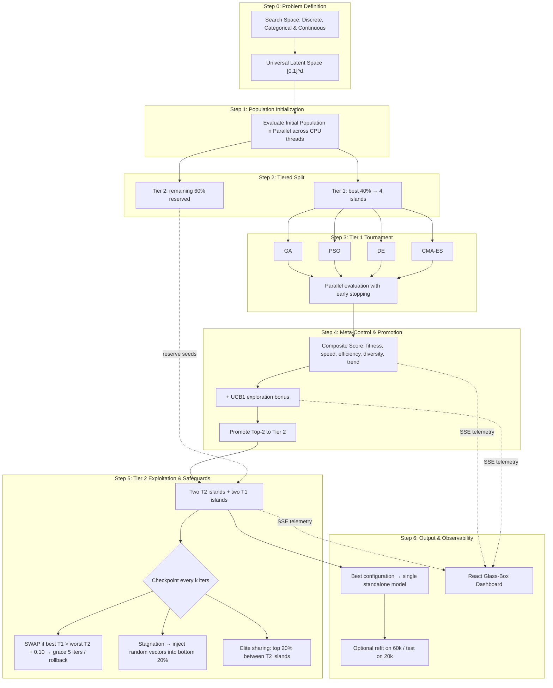

# 01 — Overview & Motivation

## 1. The problem

A model's performance depends heavily on hyperparameters that gradient descent cannot learn. Examples are the learning rate, tree depth, number of estimators, regularisation, layer sizes and the choice of model family. Practitioners usually tune them in one of three ways, and each has a weakness:

1. **Grid search and random search.** Grid search grows exponentially with the number of dimensions. Random search ignores feedback from earlier evaluations.
2. **A single heuristic or Bayesian optimizer**, such as TPE, Gaussian-process Bayesian optimisation, one GA or one PSO. Each algorithm suits some landscapes and fails on others:
   - momentum methods (PSO, CMA-ES) converge fast on smooth surfaces but get trapped in noisy or multi-modal ones;
   - GA and DE explore broadly but converge slowly near the optimum.

   Once such a tool has committed to its sampler, it cannot change strategy when the sampler stalls, so the remaining budget is wasted.
3. **Heavy ensembling** (H2O, AutoGluon stacking). Accuracy improves, but every prediction must pass through 10–50 models. That multiplies inference latency, memory and maintenance cost.

**Problem statement (from the panel deck):** AutoML systems rely on a single fixed optimizer that stagnates on non-convex hyperparameter landscapes, wasting search compute. By the No Free Lunch theorem no single optimizer dominates everywhere, so adaptive strategy switching is needed.

**Research gap:** There are no frameworks that run several optimizers concurrently, detect stagnation live, swap strategies dynamically, and still deliver a single model.

## 2. Objectives

1. Build a UCB1 multi-armed-bandit meta-engine that routes budget to the best-performing optimizer in real time.
2. Switch strategies live (tier SWAPs) based on stagnation and diversity monitoring.
3. Reach ensemble-level accuracy (93.47% on Covertype in the panel version) with a **single deployable model**, avoiding ensemble overhead. The project claims about 2 ms latency and about 150 MB of memory for this model.
4. Make the search observable live (a "glass box") through an SSE dashboard.
5. Stay dataset-agnostic: the same engine handles tabular model switching and CNN architecture search.

## 3. The title, word by word

| Title component | What it means in the system | Implemented in |
|---|---|---|
| **Dynamic** | The allocation of budget among optimizers changes during the run through promotion, SWAP, rollback and injection. | `automl_engine/engine/controller.py` |
| **Multi-Armed Bandit** | Each optimizer is an "arm". Its reward is the composite score, and a UCB1 exploration bonus `c·sqrt(ln N / n_i)` favours under-used arms. | `controller.py` (`_compute_composite`), `ucb1.py` |
| **Meta-Optimizer** | It optimises *which optimizer* gets budget, over a portfolio of GA, PSO, DE and CMA-ES arranged in a two-tier island model. | `controller.py`, `optimizers/` |
| **Automated Model Selection** | The model family is one latent dimension (`model_type` ∈ XGBoost / RandomForest / LightGBM / ExtraTrees), so the family is chosen inside the same search loop. | `core/search_space.py`, evaluators |
| **Hyperparameter Tuning** | Continuous, integer and categorical hyperparameters, plus the feature-engineering gene, are searched together. Evaluation runs in parallel, with early stopping for boosted trees. | `core/evaluator.py`, `core/covtype_evaluator.py` |

```
[ EvoSynth ]
    ├── "Dynamic Multi-Armed Bandit" ─► composite score + UCB bonus decide promotion and SWAPs
    ├── "Meta-Optimizer" ─────────────► portfolio of 4 optimizers (GA, PSO, DE, CMA-ES) in 2 tiers
    ├── "Automated Model Selection" ──► model_type gene: XGBoost / LightGBM / RandomForest / ExtraTrees (or a CNN)
    └── "Hyperparameter Tuning" ──────► 9-dimensional latent space, parallel evaluation, early stopping
```

## 4. The No Free Lunch argument

The No Free Lunch theorem for optimisation (Wolpert & Macready, 1997) says that, averaged over all problems, no optimizer outperforms any other. A tool that commits to one sampler is therefore betting that the user's landscape suits that sampler.

EvoSynth does not try to design one perfect algorithm. It keeps a portfolio of algorithms with complementary search behaviour:

| Optimizer | Strength | Weakness |
|---|---|---|
| GA | Global exploration through crossover and mutation | Slow convergence near the optimum |
| PSO | Fast movement driven by personal and global bests | Premature convergence on multi-modal or noisy landscapes |
| DE | Robust navigation by vector differences | Sensitive to loss of diversity |
| CMA-ES | Learns correlations between parameters, so it fine-tunes smooth regions well | Heavier computation, and largely local |

EvoSynth measures each optimizer's progress, diversity and trend online and moves budget to whichever currently performs best. That is the meta-optimizer answer to NFL.

## 5. Why this is not ensembling

| | Ensembling (stacking, blending, voting) | EvoSynth |
|---|---|---|
| Where it operates | Prediction space: combines the outputs of M trained models at inference time | Search space: coordinates M *search algorithms* during offline tuning |
| Deliverable | M models deployed together | **One** model configuration |
| Inference cost | O(M): latency and RAM scale with the number of models | O(1): one model |
| Purpose of the diversity | Averaging reduces variance | Diverse search strategies escape local optima |

The multiple algorithms exist **only during search**. Production receives one lean model, for example an ExtraTrees classifier with interaction features, so there is no inference penalty.

## 6. The seven-stage workflow

The README and paper describe these stages. The controller prints matching "STEP n" headers.

| Stage | Name | What happens |
|---|---|---|
| 0 | Problem definition and latent mapping | The search space (discrete, categorical and continuous) is mapped to `[0,1]^d`. |
| 1 | Parallel population initialisation | `pop_size` random vectors are evaluated in thread-pool batches with early stopping. |
| 2 | Two-tier split | The best 40% become the Tier 1 seeds, split equally into four islands. The remaining 60% are reserved for Tier 2. |
| 3 | Tier 1 tournament | GA, PSO, DE and CMA-ES evolve their islands for `t1_iters` iterations. Stagnant T1 islands get 50% random injection. |
| 4 | Meta-control and promotion | Composite score plus UCB bonus are computed, and the top two optimizers are promoted to Tier 2 and absorb the reserve. |
| 5 | Tier 2 exploitation and safeguards | T2 and the remaining T1 run until the budget is spent. Every `k` iterations the checkpoint handles SWAP with grace and rollback, stagnation injection, and top-20% elite sharing. |
| 6 | Output and observability | The best individual is decoded into a single model configuration. Optionally it is refit on held-out data. Telemetry streams to the dashboard throughout. |



## 7. The architecture figure (`assets/arch.png`), described

The figure reads left to right in seven coloured blocks, with a control loop drawn underneath:

1. **Input layer (blue).**
   - "Search Space": 9 dimensions, namely `model_type`, `fe_strategy` and 7 hyperparameters.
   - "Any Dataset (Dataset Agnostic)".
   - A note that the search space and fitness metric are configured per task.
2. **Initialization (green).**
   - "Population Generator" creates N random individuals.
   - "Fitness Evaluator" assigns initial fitness using 4 model families (XGBoost, LightGBM, RandomForest, ExtraTrees) and the "Generic Feature Engineer" (none | stats | interactions).
   - An arrow labelled **40% Population** goes to Tier 1. An arrow over the top labelled **60% Population** goes to Tier 2.
3. **Tier 1 — Competition arena (red).** DE, PSO, CMA-ES and GA feed into the **Composite Scoring Engine**.
4. **Tier 2 — Working population (purple).**
   - "Best Algorithm" and "2nd Best Algorithm" receive the promoted strategies.
   - "Periodic Sharing" exchanges the top 20% between them every k iterations.
5. **Output layer (grey).** "Best Single Standalone Model (Zero Ensemble)", labelled "2 ms inference latency, ~150 MB RAM".
6. **Post-search phase 2 (orange).** "Generalization Refit": retrain the winner on 60k samples and test on a held-out 20k. The final validated result is **93.47%**.
7. **Control layer (green, bottom).**
   - Inputs: T1 and T2 performance.
   - Components:
     - **Tier Performance Comparator** (sends scores),
     - **Stagnation Detector**,
     - **UCB1 Bandit Selector** (on "T2 persistent stagnation"),
     - **Promotion & Demotion Engine** (swaps strategies, forces swaps, promotes a strategy and reassigns its island).
   - Its output, "promote strategy + reassign island", feeds back into Tier 2.
8. **Diversity injection (dashed green).**
   - Triggered by "stagnation detection in T1, T2".
   - Contains three mechanisms:
     - **T1 Global Reset** (keep the top x%, replace the rest),
     - **T1 Batch Refresh** (refresh the bottom 50%),
     - **T2 Island Diversity Injection** (replace the bottom 20%).
   - Dashed arrows feed back to the Tier 1 and Tier 2 populations.

*(The paper's figure caption numbers the same blocks 1–8. The slide deck uses an updated version, `arch_updated.png`, of the same diagram.)*

## 8. Core claims, as the project states them

1. **Escape from premature convergence.** On Covertype, GA was promoted to Tier 2 but stalled. PSO, still in Tier 1, overtook it on UCB score (0.720 vs 0.547) and a live SWAP promoted PSO, which then found the winning configuration (see [08-results.md](08-results.md) §5).
2. **Dataset-agnostic feature engineering.** With no column names, generic row statistics and pairwise interactions lifted Covertype test accuracy into the 93–94% range.
3. **Pareto efficiency.** Accuracy at ensemble level from a single model and a modest budget.
4. **Throughput.** Thread-pool parallelism and early stopping cut initial population evaluation from 44.8 s to 3.9 s (11.5× in the paper's speed-up benchmark).
5. **Cross-domain.** The same engine performs CNN NAS on handwritten digits (95.33% in the paper, 95.78% in the panel deck).
