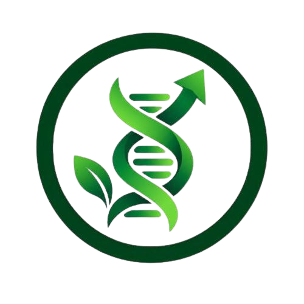
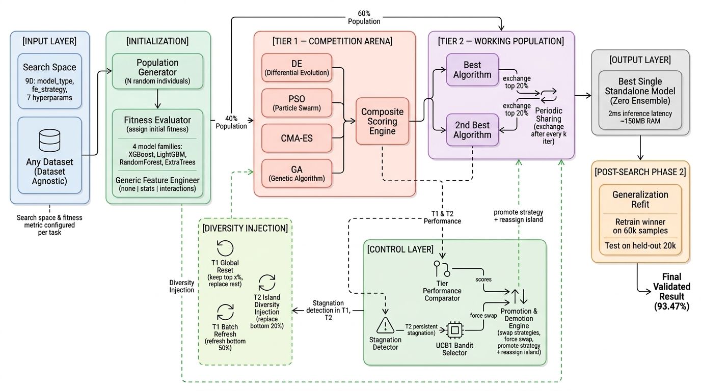

# EvoSynth: Dynamic Multi-Armed Bandit Meta-Optimizer for Automated Model Selection and Hyperparameter Tuning

<p align="center">
  
</p>

[](https://www.python.org/downloads/)
[](https://pytorch.org/)
[](https://fastapi.tiangolo.com/)
[](https://react.dev/)
[](https://opensource.org/licenses/MIT)

> **EvoSynth** is a next-generation Automated Machine Learning (AutoML) and Neural Architecture Search (NAS) framework. Rather than relying on a single static optimizer or expensive post-hoc ensembles, EvoSynth functions as a **Dynamic Meta-Optimizer**: it deploys multiple evolutionary and swarm intelligence algorithms simultaneously and uses a **Multi-Armed Bandit (UCB1)** controller to dynamically allocate computational budget in real time to the most effective strategy.

---

## 🎯 Why This Title? (Workflow-to-Title Mapping)

When defending this project before an evaluation panel, every keyword in the title maps directly to a concrete phase of the system workflow:

```
[ EvoSynth ]
    │
    ├── 1. "Dynamic Multi-Armed Bandit" ──► UCB1 Controller routes compute budget on-the-fly based on exploration bonuses
    │
    ├── 2. "Meta-Optimizer" ──────────────► Operates on a portfolio of 4 competing optimizers (GA, PSO, DE, CMA-ES)
    │
    ├── 3. "Automated Model Selection" ───► Chooses optimal architecture (XGBoost, LightGBM, Random Forest, PyTorch CNN)
    │
    └── 4. "Hyperparameter Tuning" ───────► Discovers optimal continuous/discrete parameters via Early Stopping & Latent Space
```

| Title Component | Concrete Workflow Stage | Source Implementation |
| :--- | :--- | :--- |
| **Dynamic Multi-Armed Bandit** | The UCB1 bandit ranks the optimizer families for every promotion and SWAP: $UCB = \text{composite} + c \sqrt{\frac{\ln N}{n_i}}$ with $c = 0.1$, where the composite combines fitness, speed, efficiency, latent diversity and trend. | [`src/evosynth/engine/bandit.py`](src/evosynth/engine/bandit.py) |
| **Meta-Optimizer** | Controls and coordinates multiple underlying optimization algorithms (Genetic Algorithm, Particle Swarm Optimization, Differential Evolution, CMA-ES) in a 2-Tier Island Model. | [`src/evosynth/engine/controller.py`](src/evosynth/engine/controller.py) |
| **Automated Model Selection** | Decodes latent vectors to dynamically switch model families (`XGBoost`, `LightGBM`, `RandomForest`, or PyTorch `CNN`) within the same search loop. | [`src/evosynth/search_spaces/`](src/evosynth/search_spaces/) |
| **Hyperparameter Tuning** | Evaluates continuous & discrete parameters in parallel with early stopping to prevent wasted compute on suboptimal branches. | [`src/evosynth/evaluators/tabular.py`](src/evosynth/evaluators/tabular.py) |

---

## 🔄 End-to-End System Workflow & Architecture

<p align="center">
  
</p>

The EvoSynth workflow operates in **7 discrete, automated stages**:

1. **Step 0 — Problem Definition & Universal Latent Mapping**: Maps mixed discrete, categorical, and continuous hyperparameter spaces and neural architectures into a unified continuous hypercube $[0, 1]^d$.
2. **Step 1 — Parallel Population Initialization**: Generates and evaluates the initial population asynchronously across CPU worker threads with early stopping.
3. **Step 2 — Two-Tier Co-evolutionary Split**: A stratified split gives **Tier 1** 40% of the population as four equal islands, and keeps 60% as the **Tier 2 reserve** in two groups. Every island and group gets a mix of good and weak members, so no optimizer starts with an advantage.
4. **Step 3 — Tier 1 Tournament**: Simultaneous execution of 4 competing metaheuristic algorithms (Genetic Algorithm, Particle Swarm Optimization, Differential Evolution, CMA-ES) over candidate vectors.
5. **Step 4 — Meta-Control & Dynamic Promotion**: The Composite Scoring Engine measures each island's fitness, speed (gain since the last check), efficiency (gain per evaluation-second), latent diversity and trend (slope over the last 3 checks); the **UCB1 bandit** adds an exploration bonus and promotes the top two families.
6. **Step 5 — Tier 2 Exploitation & Safeguards**: The two promoted islands (each its Tier 1 island plus one reserve group) exchange their top 20% every k iterations. At each checkpoint a Tier 1 family whose UCB beats the weakest Tier 2 family by more than 0.10 is swapped in (with a grace period, rollback and cooldown), and islands without improvement receive fresh random vectors.
7. **Step 6 — Selection, Output & Observability**: The top 5 distinct configurations are re-scored with 5-fold CV (confirm before select); the selected one is retrained on the train rows and scored once on held-out test rows, with its inference latency and size measured. The output is a **single standalone model**; live telemetry streams via Server-Sent Events (SSE) to the React dashboard.

<details>
<summary><b>Click to expand Text Flowchart (Mermaid)</b></summary>

```mermaid
flowchart TD
    subgraph Step0["Step 0: Problem Definition"]
        A[Search Space: Discrete, Categorical & Continuous] --> B[Universal Latent Space: Continuous Hypercube [0, 1]^n]
    end

    subgraph Step1["Step 1: Population Initialization"]
        B --> C[Evaluate Initial Population in Parallel across CPU Cores]
    end

    subgraph Step2["Step 2: Tiered Split"]
        C --> D1[Tier 1: 40% as 4 stratified islands]
        C --> D2[Tier 2 reserve: 60% in 2 stratified groups]
    end

    subgraph Step3["Step 3: Tier 1 Tournament"]
        D1 --> E1[Genetic Algorithm]
        D1 --> E2[Particle Swarm Optimization]
        D1 --> E3[Differential Evolution]
        D1 --> E4[CMA-ES]
        E1 & E2 & E3 & E4 --> F[Evaluate Iterations in Parallel with Early Stopping]
    end

    subgraph Step4["Step 4: Meta-Control & Promotion"]
        F --> G[Composite Scoring Engine: Fitness + Speed + Efficiency + Diversity + Trend]
        G --> H[UCB1 Multi-Armed Bandit Exploration Bonus]
        H --> I[Promote Top-2 Strategies to Tier 2 Exploitation]
    end

    subgraph Step5["Step 5: Tier 2 Exploitation & Safeguards"]
        I --> J1[Cooperative Co-evolution Islands]
        D2 -. Seed Transfer .-> J1
        J1 --> K[Pairwise Elite Sharing: exchange top 20%]
        J1 --> L{Checkpoint every k iterations}
        L -- Tier 1 family beats weakest Tier 2 by > 0.10 --> S[SWAP]
        L -- No improvement --> M[Random Latent Injection]
        L --> N[Continue Search Loop]
    end

    subgraph Step6["Step 6: Output & Observability"]
        N --> O[Confirm Before Select: top 5 re-scored with 5-fold CV]
        O --> R[Refit on train rows, score once on held-out test rows]
        R --> P[Single Standalone Model + measured inference cost]
        G & H & J1 -. Live Telemetry SSE .-> Q[React Glass-Box Dashboard]
    end
```

</details>

---

## 💡 Core Innovations & Theoretical Defense

### 1. How EvoSynth Differs from Model Ensembling
A frequent question in AutoML is: *"Why not just train multiple models and ensemble them (e.g., stacking, blending, or voting)?"*
* **Inference Overhead:** Model ensembles combine multiple trained estimators at prediction time. Serving an ensemble in production multiplies latency, memory usage, and operational maintenance by the number of models in the ensemble.
* **Single Optimal Deliverable:** EvoSynth uses dynamic algorithm selection strictly in the **offline search and optimization phase**. The competing evolutionary algorithms work together to discover a **single, lean, optimal model configuration** (or neural architecture) that whose serving cost is simply that of the chosen model (measured per run).
* **Search Diversity vs. Predictive Aggregation:** Ensembles average model predictions to smooth variance. EvoSynth coordinates diverse search strategies to explore complex, multi-modal parameter spaces and locate global optima that individual optimizers fail to find.

### 2. Theoretical Superiority: The "No Free Lunch" Defense
According to the **No Free Lunch (NFL) Theorem for Optimization** (Wolpert & Macready, 1997), no single optimization algorithm can outperform all others across all problem landscapes:
* Algorithms with strong global exploration (e.g., Genetic Algorithms with crossover/mutation) excel on rugged landscapes but converge slowly on unimodal basins.
* Algorithms with aggressive exploitation and momentum (e.g., Particle Swarm Optimization, CMA-ES) converge rapidly on smooth convex topologies but become permanently trapped in local minima or noisy label regimes.

EvoSynth overcomes the NFL limitation by maintaining a **dynamic portfolio of complementary search algorithms**. By continuously evaluating fitness velocity, population diversity, and convergence trends, the UCB1 Bandit routes computational resources on the fly to the algorithm best suited for the current phase of the optimization landscape.

### 3. Direct Comparison: EvoSynth vs. Optuna vs. FLAML vs. H2O.ai

| Feature / Capability | Optuna | FLAML (Microsoft) | H2O.ai AutoML | **EvoSynth (Our System)** |
| :--- | :--- | :--- | :--- | :--- |
| **Search Paradigm** | Single Bayesian (TPE/CMA) | Cost-Frugal Optimization (CFO) | Random/Grid + Bayesian | **UCB1 Dynamic Multi-Armed Bandit** |
| **Algorithm Strategy** | Single static sampler | Single randomized local search | Static portfolio / sequential | **Cooperative Co-evolution (4-Optimizer Swarm)** |
| **Strategy Switching** | ❌ None (Fixed sampler) | ❌ None | ❌ None | **✅ Live Tier SWAPs (UCB margin 0.10)** |
| **Diversity Safeguard** | ❌ None | ❌ None | ❌ None | **✅ Explicit Latent Space Diversity Tracking** |
| **Feature Engineering** | ❌ Manual | Limited heuristics | Fixed preprocessing | **✅ Searchable Dataset-Agnostic Gene** |
| **Production Deliverable** | Single model | Single model | Stacked ensemble (many models) | **Single model (latency and size measured per run)** |
| **Observability** | Optuna Dashboard (Static polling) | Terminal logs | Web tables | **Real-Time "Glass-Box" SSE Telemetry Dashboard** |

*(For complete mathematical derivations and empirical comparisons, see [docs/research/comparative_analysis.md](docs/research/comparative_analysis.md).)*

---

## 🌲 Results: Covertype and Adult (Phase 5 smoke run)

Every method is scored once on held-out test rows that no search or selection ever sees. EvoSynth, Random Search and Optuna get 500 evaluations each and go through the same confirm-before-select and refit; FLAML gets the same wall time as EvoSynth. Searches use a fixed 10,000-row subset of each dataset's search rows; the exact splits are published in [EvoSynth-Bench v2.0.0](https://doi.org/10.5281/zenodo.23645119). **One seed (42)**, so differences of a few hundredths between tuned methods are ties.

| Method | Covertype test accuracy | Search time | Adult test ROC AUC | Search time |
| :--- | :---: | :---: | :---: | :---: |
| Best untuned model | 89.77% (ExtraTrees) | – | 92.92% (LightGBM) | – |
| FLAML | 92.53% | 13.0 min | **93.13%** | 3.0 min |
| Random Search | **93.89%** | 42.4 min | 92.98% | 19.1 min |
| Optuna TPE | 93.87% | 49.8 min | 92.95% | 3.3 min |
| **EvoSynth** | **93.89%** | **12.2 min** | 92.96% | **3.0 min** |

### Key Empirical Findings
1. **Level with the strongest tuned baselines.** EvoSynth ties Random Search and Optuna on both datasets (within 0.03 points) under an identical protocol. FLAML is 1.4 points lower on Covertype and best on Adult.
2. **Right model family per dataset.** ExtraTrees with automatically generated interaction features on Covertype (4.1 points above the best untuned model), XGBoost with no feature engineering on Adult.
3. **Matches the best single optimizer without choosing it in advance.** In the CVGS-500 ablation EvoSynth reached 82.35% search CV, tied with PSO and CMA-ES run alone; the best single optimizer changes from run to run.
4. **Live meta-decisions.** In the Covertype run DE and CMA-ES were promoted, GA was swapped in (UCB 0.592 vs 0.369) and rolled back after its grace period, and CMA-ES found the winner. On Adult, PSO found the winner after two swaps.
5. **A plateau caps Covertype.** The five best Covertype configurations build the same effective model (forests are capped at 150 trees during the search), so every competent search reaches the same score. Harder datasets and more seeds are needed to separate optimizers.
6. **Inference cost is that of the chosen model**, measured on one thread: 0.26 ms/row and 0.4 MB for the Adult XGBoost; 12.5 ms/row and 470 MB for the Covertype ExtraTrees.
7. **Vision NAS:** 81.8% validation accuracy on Fashion-MNIST in 160 evaluations with the same engine.

Full tables, charts and caveats: [handbook/08-results.md](handbook/08-results.md). Reproduce with `py -3.14 tools/run_experiments.py smoke`. The panel-review (v1) numbers are archived in `results/archive/2026-11-19_covertype_v1/`; they had engine bugs and a refit that discarded the baselines' tuned hyperparameters, so they are not comparable.

---

## ⚡ Performance & Speed Optimizations

1. **Parallel evaluation:** candidates are evaluated concurrently with `concurrent.futures.ThreadPoolExecutor` (up to 8 workers by default; the model libraries release the GIL while training).
2. **Early stopping on boosted models:** XGBoost and LightGBM stop after 10 rounds without improvement on a 15% slice of the training fold.

Measured by `evosynth speedup` on 40 Covertype configurations with 12 threads:

| Condition | Time | Speed-up |
| :--- | :---: | :---: |
| Sequential | 255.6 s | 1.00× |
| Sequential + early stopping | 219.0 s | 1.17× |
| Parallel (12 threads) | 43.7 s | 5.85× |
| **Parallel + early stopping** | **41.9 s** | **6.10×** |

Almost all of the gain comes from parallel evaluation. (Earlier versions of this README quoted 11.5×, which was never measured by code in the repository.)

---

## 📂 Repository Architecture & Directory Structure

```text
EvoSynth/
├── pyproject.toml                # Package metadata, pinned dependencies, `evosynth` command
├── requirements.txt              # `-e .[all]` (installs the package with every extra)
├── settings/                     # EVERY tunable value (TOML), one file per topic + README index
│   ├── engine.toml               # Budget, tiers, UCB c, composite weights, safeguards
│   ├── optimizers.toml           # GA / PSO / DE / CMA-ES constants
│   ├── search_spaces.toml        # Model families, FE strategies, hyperparameter ranges
│   ├── evaluation.toml           # CV, early stopping, feature engineering, refit
│   ├── datasets.toml             # One section per dataset
│   ├── experiments.toml          # Presets for each command
│   └── run.toml, telemetry.toml
├── src/evosynth/                 # The Python package
│   ├── cli.py                    # `evosynth run | scale | ablation | baselines | nas | serve | settings | datasets`
│   ├── config.py                 # Loads, merges and validates settings/
│   ├── core/                     # Individual, latent-vector decoding
│   ├── search_spaces/            # Tabular (8D), NAS and toy ConfigSpace spaces
│   ├── datasets/                 # Dataset registry, loaders (download to .data/), splits
│   ├── features/                 # Dataset-agnostic feature engineering
│   ├── models/                   # Model factory, post-search refit, CNN
│   ├── evaluators/               # TabularEvaluator, ImageCNNEvaluator, toy objective
│   ├── engine/                   # DynamicOptimizer, UCB1 bandit, composite scoring, tiers
│   ├── optimizers/               # GA, PSO, DE, CMA-ES (ask / tell)
│   ├── telemetry/                # Event reporter, run logging, FastAPI SSE server
│   └── experiments/              # search, scaling, ablation, baselines, nas, run folders
├── results/                      # One folder per run: <experiment>/<dataset>/<variant>/seed_<k>/
│   └── archive/                  # Panel-review (v1) results, kept unchanged
├── tools/run_experiments.py      # Experiment plans (smoke / lean / core) for the re-runs
├── dashboard/                    # React live telemetry dashboard (Vite + Tailwind CSS)
├── docs/                         # VitePress documentation site
│   ├── research/                 # Comparative analysis, related papers
│   └── public/                   # Logo and architecture figure
├── handbook/                     # Internal project handbook, incl. panel defence (not on the site)
└── paper/                        # Paper and slide sources (LaTeX), figures, links
```

---

## 🚀 Quickstart & Usage

### 1. Installation

Requires Python 3.11+ (developed on 3.14).

```bash
# Clone the repository
git clone https://github.com/paarthureddy/EvoSynth.git
cd EvoSynth

# Create and activate virtual environment
python -m venv venv
venv\Scripts\activate      # On Windows
# source venv/bin/activate # On Linux/macOS

# Install EvoSynth with all extras (NAS, baselines, tests)
pip install -e ".[all]"
```

This installs the `evosynth` command (also available as `python -m evosynth`). Datasets are
downloaded on first use into `.data/` (git-ignored), or all at once with `evosynth datasets download`
(about 150 MB). `evosynth datasets list` shows every registered dataset, its metric and whether it is cached.

### 2. Run Real-World Benchmark (UCI Forest Covertype)
Executes dynamic meta-optimization across 4 model families (XGBoost, LightGBM, RandomForest, ExtraTrees) with automated dataset-agnostic feature engineering and post-search generalization refit:
```bash
evosynth run                         # Fast benchmark (preset search_demo: 200 evals, pop=40)
evosynth run --full                  # Full benchmark (preset search_full: 500 evals, pop=40)
evosynth scale --budget 500          # Budget-scaling run with checkpoints (300 / 500 / 1000)
evosynth ablation --setup CVGS-500   # Isolated GA / PSO / DE / CMA-ES vs EvoSynth
                                     #   (--splits stratified,random,elite adds the tier-split ablation)
evosynth baselines --test all        # Untuned defaults (4 families), Random Search, Optuna, FLAML
evosynth run --dataset higgs         # any registered dataset: covertype (default), higgs, adult,
                                     # airlines, poker_hand, miniboone, jannis
evosynth speedup                     # measure the parallel-workers + early-stopping speed-up
evosynth summary                     # results/summary/: mean ± std tables over seeds, convergence curves
```

Every method sees the same rows: a held-out test set is split off first, and the search and the
refit draw from the rest (`settings/datasets.toml`). Each dataset is scored with its own metric
(accuracy for the multiclass datasets, ROC AUC for the binary ones). After the search, the top 5
configurations are re-scored with 5-fold CV before the winner is chosen (`[selection]`).
Random Search and Optuna go through exactly the same evaluator, confirmation and refit, and every
refitted model's inference latency and size are measured and stored in `result.json`.

Each run writes to `results/<experiment>/<dataset>/<variant>/seed_<k>/` (`manifest.json` with the
exact settings, git commit and library versions; `result.json`; `run.log`; ...).

### 3. Change Any Setting
All hyperparameters, weights and presets live in [`settings/`](settings/README.md). Edit a file, or
override a value for one run:
```bash
evosynth settings show engine
evosynth run --set bandit.c=0.2 --set composite.fitness=0.4 --set composite.speed=0.15
```

### 4. Run Deep Learning Vision NAS
Discovers optimal CNN layer topology (convolutional channels, fully connected units, activation functions) and training hyperparameters in PyTorch, on Fashion-MNIST (10,000 training / 2,500 validation images during search; the official test set is held out):
```bash
evosynth nas
```

### 5. Launch Live Telemetry Dashboard

In Terminal 1 (Start the Telemetry API):
```bash
evosynth serve
```

In Terminal 2 (Start the React Dashboard):
```bash
cd dashboard
npm install
npm run dev
```
Open [http://localhost:5173](http://localhost:5173) in your browser to monitor algorithm promotion, real-time UCB1 scores, diversity trends, and telemetry logs live.

---

## 📜 Documentation Site

To browse the complete technical documentation site locally:
```bash
cd docs
npm install
npm run docs:dev
```
Open [http://localhost:5173](http://localhost:5173) (or the displayed VitePress port) to view full guides, algorithm math, API references, and developer tutorials.

The complete project handbook (architecture, engine internals, experiments, results, setup) is in
[`handbook/`](handbook/README.md); the paper and slides are in [`paper/`](paper/README.md).

---

## 📄 License & Attribution

Released under the [MIT License](LICENSE). Developed by Group G002 as an academic capstone project.
