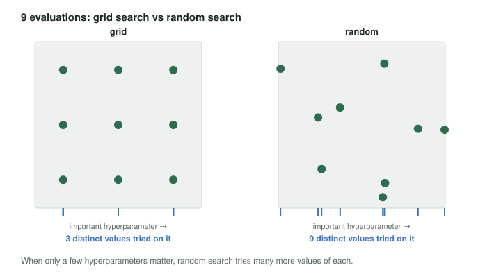
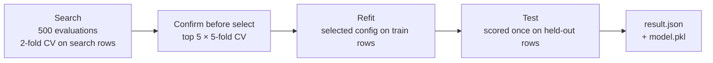
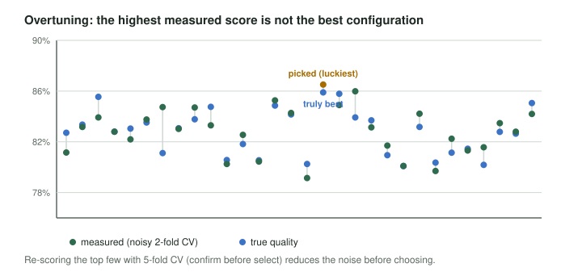

# 00b — Prerequisites 2: AutoML and Hyperparameter Search

This file explains what AutoML is, how hyperparameter search works, and the vocabulary EvoSynth's experiments use: configuration, evaluation, budget, refit, seed and others. It assumes [00a](00a-prerequisites-ml.md).

---

## 1. AutoML

**Automated Machine Learning (AutoML)** automates the choices a data scientist makes by hand: which model family to use, which hyperparameters to set, and which features to build. Given a dataset and a metric, an AutoML system searches for the combination that scores best.

Three related problems:

- **Hyperparameter optimisation (HPO):** find good hyperparameters for one fixed model type.
- **Model selection:** choose the best model type.
- **CASH (Combined Algorithm Selection and Hyperparameter optimisation):** both at once, which is what EvoSynth's tabular search does: `model_type` is one dimension of the search, next to the hyperparameters.

**Neural Architecture Search (NAS)** is the same idea for neural networks: searching over layer sizes and training settings. EvoSynth's `evosynth nas` command does a small version.

---

## 2. The search problem

### 2.1 Search space and configuration

The **search space** lists every hyperparameter with its type and range (EvoSynth's is in [00a](00a-prerequisites-ml.md) §2.3). One complete choice of every hyperparameter is a **configuration**, for example:

```
model_type = LightGBM, fe_strategy = interactions, n_estimators = 310, max_depth = 7,
learning_rate = 0.042, subsample = 0.83, colsample_bytree = 0.61, reg_alpha = 1.9
```

Hyperparameters come in kinds the search must handle: **continuous** (learning rate), **integer** (number of trees), **categorical** (model type), sometimes on a **log scale**, and sometimes **conditional** (only meaningful when another choice is made, such as learning rate only for boosting).

### 2.2 The objective and its evaluation

The **objective** is the function being optimised: configuration in, score out. Here the score is the cross-validated metric on the search rows. Computing it once is an **evaluation**, and it is expensive: it means training a model, often several (one per CV fold). In EvoSynth one evaluation takes about 1–9 seconds even with 8 parallel threads.

The objective is a **black box**: we can only ask it for a score, there is no formula or gradient. It is also **noisy**: the same configuration can score a little differently with a different CV split, so a lucky score is not always a better configuration.

### 2.3 Budget

The **budget** is how many evaluations the search may spend, e.g. 500. A good search method finds a good configuration within the budget. Comparing methods fairly means giving them the same budget (or, for time-based methods like FLAML, the same wall-clock time).

---

## 3. Search methods

### 3.1 Grid search

Try every combination of a few values per hyperparameter. Simple, but the number of combinations explodes: 5 values for each of 8 hyperparameters is 390,625 evaluations.

### 3.2 Random search



Sample configurations uniformly at random. Surprisingly strong, because usually only a few hyperparameters matter and random sampling tries many different values of each. It does not learn from earlier results. EvoSynth uses it as a baseline.

### 3.3 Bayesian optimisation and TPE

**Bayesian optimisation** builds a cheap statistical model of the objective (a **surrogate**) from the configurations evaluated so far, and uses it to pick the next configuration that looks most promising, balancing "probably good" with "still uncertain". **TPE (Tree-structured Parzen Estimator)**, used by the **Optuna** library, is a popular variant: it models what good and bad configurations look like and samples where good ones are more likely. Optuna TPE is one of EvoSynth's baselines.

### 3.4 Evolutionary and swarm methods

These keep a **population** of configurations and improve it over generations by recombining and mutating the good ones (GA, DE, CMA-ES) or by moving them like a flock (PSO). They are explained in [00c](00c-prerequisites-evolutionary.md). EvoSynth runs four of them and decides online which ones get the budget.

### 3.5 AutoML systems

- **FLAML** (Microsoft): a fast, cost-aware AutoML library that tries cheap models first and searches with a time budget. A baseline in EvoSynth.
- **AutoGluon, H2O AutoML:** train many models and combine them into a **stacked ensemble** (a model that combines the predictions of other models). This is often very accurate, but the result is many models served together, with higher latency and memory.
- **TabPFN:** a recent *pretrained* model for small tabular datasets that predicts without per-dataset training. It shows how fast the field moves, and why EvoSynth focuses on the search strategy rather than competing as a complete AutoML system.

### 3.6 No Free Lunch

The **No Free Lunch theorem** for optimisation says that, averaged over all possible problems, no search algorithm beats any other. On a specific problem one method can be much better, but which one depends on the problem. This is EvoSynth's motivation: instead of betting on one optimizer, run several and shift the budget to whichever is working on *this* problem.

---

## 4. From the search to a final model



### 4.1 Overtuning



The search's best score is the **maximum of many noisy estimates**, so it tends to be the configuration that was luckiest on the validation folds, not necessarily the best one. Picking it and reporting its validation score is **overtuning**: the score is too optimistic and the configuration may generalise worse. This was the topic of the AutoML 2025 best paper.

### 4.2 Confirm before select

EvoSynth's remedy: after the search, take the **top 5 distinct configurations** and **re-score them with 5-fold CV**, then select the one with the best *confirmed* score. More folds mean less noise, so the choice is more reliable. These extra fits are reported but not counted in the search budget.

### 4.3 Refit

The search scored configurations on a subset (the search rows, with 2-fold CV). The **refit** trains the selected configuration once more on the larger **train rows** (e.g. 60,000), producing the final model, and scores it **once** on the held-out **test rows**. That test score is the number that represents real-world performance. In EvoSynth every tuned method (EvoSynth, Random Search, Optuna) uses exactly the same refit, so their test scores are comparable.

### 4.4 Baselines

A **baseline** is a simple or established method that a new method must beat to be worth anything:

- **Untuned defaults:** each model family with its library's default settings; the floor.
- **Random Search, Optuna TPE, FLAML:** established search methods.
- **Each EA alone (ablation):** to show the combination adds something beyond its best member.

An **ablation** removes or changes one part of a system to measure that part's contribution, e.g. running EvoSynth with a different tier split.

---

## 5. Reproducibility

### 5.1 Seeds

Searches use random numbers. A **seed** is the starting value of a random-number generator; the same seed gives the same sequence of random numbers, and so the same run. EvoSynth has two: `run.seed` (all search randomness) and `run.data_seed` (how the data is split). Same seeds, same results.

### 5.2 Several seeds

One run can be lucky. Repeating it with different seeds and reporting the **mean ± standard deviation** shows how much results vary. With many tasks and seeds, methods are compared by **average rank** and with **statistical tests** (e.g. Wilcoxon, Friedman) instead of single numbers.

### 5.3 Surrogate benchmarks

Because real evaluations are slow, the research community publishes **surrogate benchmarks**: tables or fast predictive models built from thousands of precomputed evaluations, which return a configuration's score in about a millisecond without training anything. They make many-seed, many-task optimizer comparisons cheap. EvoSynth's To-do proposals suggest using them.

---

## 6. Glossary

| Term | Meaning |
|---|---|
| AutoML | Automating model, hyperparameter and feature choices |
| HPO | Hyperparameter optimisation |
| CASH | Choosing the model type and its hyperparameters together |
| NAS | Searching over neural-network architectures |
| Search space | All hyperparameters with their types and ranges |
| Configuration | One complete choice of every hyperparameter |
| Objective | The function being optimised (configuration → score) |
| Evaluation | Computing the objective once (training and scoring) |
| Black box | A function we can only query, without formula or gradient |
| Budget | Number of evaluations (or seconds) a search may use |
| Random search | Sampling configurations uniformly at random |
| Bayesian optimisation / TPE | Search guided by a model of past results (Optuna) |
| Stacked ensemble | A model combining other models' predictions |
| No Free Lunch | No optimizer is best on every problem |
| Overtuning | Picking a configuration that was only lucky on noisy validation |
| Confirm before select | Re-scoring the top candidates with more folds before choosing |
| Refit | Retraining the selected configuration on more data for the final model |
| Baseline | A reference method a new method must beat |
| Ablation | Removing or changing one part to measure its effect |
| Seed | Starting value of a random-number generator |
| Surrogate benchmark | Precomputed results that answer a configuration's score instantly |

---

## Quiz

**1.** What does CASH stand for, and which EvoSynth hyperparameter makes its search a CASH problem rather than plain HPO?
<details><summary>Answer</summary>Combined Algorithm Selection and Hyperparameter optimisation. The `model_type` gene, which chooses the model family inside the same search.</details>

**2.** Why is one evaluation in EvoSynth expensive?
<details><summary>Answer</summary>It trains a model once per CV fold on thousands of rows (about 1–9 seconds even with 8 threads).</details>

**3.** A grid search tries 4 values for each of 8 hyperparameters. How many evaluations is that?
<details><summary>Answer</summary>4⁸ = 65,536.</details>

**4.** What does TPE use that random search does not?
<details><summary>Answer</summary>The results of earlier evaluations: it models what good and bad configurations look like and samples where good ones are more likely.</details>

**5.** In one sentence, why does the No Free Lunch theorem motivate EvoSynth?
<details><summary>Answer</summary>No single optimizer is best everywhere, so running several and shifting budget to whichever works on the current problem avoids betting on the wrong one.</details>

**6.** The best of 500 noisy CV scores is 86.6%. Why might the configuration behind it not be the best one?
<details><summary>Answer</summary>Because it is the maximum of many noisy estimates; it may simply have been the luckiest on those folds (overtuning).</details>

**7.** Put in order: (A) refit on the train rows; (B) search with 2-fold CV on the search rows; (C) score once on the test rows; (D) re-score the top 5 with 5-fold CV.
<details><summary>Answer</summary>B → D → A → C.</details>

**8.** Why do Random Search and Optuna go through exactly the same confirmation and refit as EvoSynth?
<details><summary>Answer</summary>So the comparison measures only the search strategy; any difference in test score then comes from which configuration each method found, not from different retraining.</details>

**9.** True or false: running an experiment twice with the same `run.seed` and `run.data_seed` gives identical results in EvoSynth.
<details><summary>Answer</summary>True; all randomness in the search and in the data splits comes from those seeds.</details>

**10.** What is an ablation, and give one EvoSynth example.
<details><summary>Answer</summary>Changing or removing one part of a system to measure its contribution; e.g. running each EA alone against EvoSynth, or running EvoSynth with the random or elite tier split.</details>

**11.** Why are surrogate benchmarks useful for comparing optimizers?
<details><summary>Answer</summary>They return a configuration's score in about a millisecond, so many tasks and seeds can be run cheaply and differences between optimizers become statistically solid.</details>
