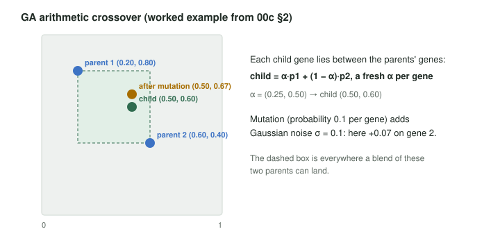
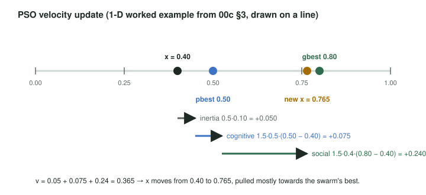
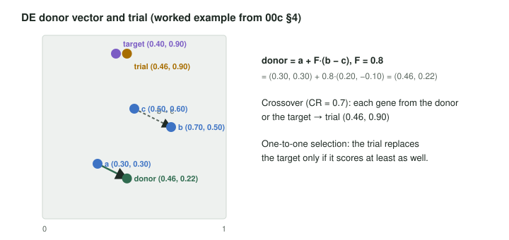
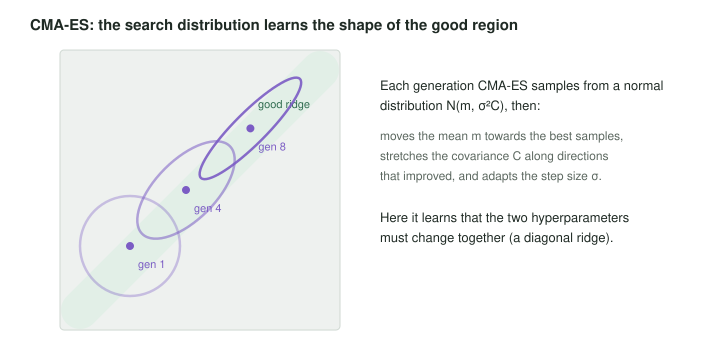
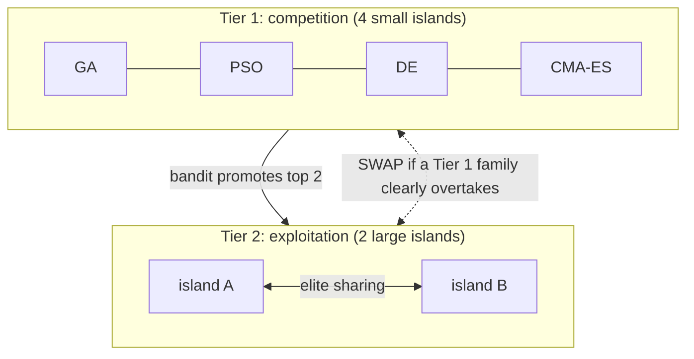
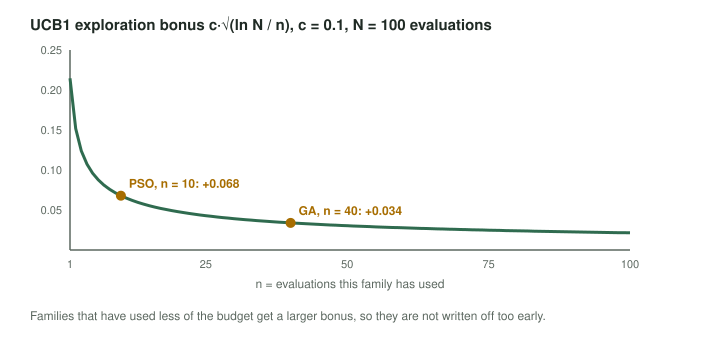

# 00c — Prerequisites 3: Evolutionary Algorithms and Bandits

This file explains the four optimizers EvoSynth runs (GA, PSO, DE, CMA-ES), the island model they live in, and the multi-armed bandit that decides between them. It assumes [00a](00a-prerequisites-ml.md) and [00b](00b-prerequisites-automl.md).

Throughout, a configuration is written as a **vector of numbers between 0 and 1**, one per hyperparameter (EvoSynth's "latent space", explained in §6). Examples use 2 dimensions so they fit on paper; EvoSynth uses 8.

---

## 1. Vocabulary of evolutionary computation

| Term | Meaning | In EvoSynth |
|---|---|---|
| Individual | One candidate solution | One configuration (a vector in [0,1]^8) |
| Fitness | How good an individual is (higher is better) | Its CV score in % |
| Population | The set of individuals kept at once | An island, e.g. 4 or 16 configurations |
| Generation / iteration | One round of proposing and evaluating new individuals | One `ask` → evaluate → `tell` cycle |
| Selection | Preferring fitter individuals as parents or survivors | Tournaments, one-to-one replacement |
| Crossover (recombination) | Building a child from two or more parents | GA's blend, DE's binomial crossover |
| Mutation | A small random change | GA's Gaussian noise, DE's difference vector |
| Exploration | Trying new regions of the space | Mutation, diversity, random injection |
| Exploitation | Refining around the best found so far | Moving towards the best, small steps |
| Convergence | The population clusters around one point | Diversity drops |
| Premature convergence | Converging before finding a good region | A stuck island |
| Stagnation | No improvement for several generations | Triggers injection in EvoSynth |

Every algorithm below balances **exploration** and **exploitation** differently, which is why they behave differently on different problems.

---

## 2. Genetic Algorithm (GA)



Inspired by natural selection.

1. **Selection (tournament):** pick 2 individuals at random and keep the fitter one as parent 1; repeat for parent 2.
2. **Crossover (arithmetic blend):** for each dimension, the child's value is a random mix of the parents': `child = α·p1 + (1−α)·p2`, with a fresh random α between 0 and 1.
3. **Mutation:** each dimension, with probability 0.1, gets Gaussian noise with standard deviation 0.1; values are clipped to [0, 1].
4. **Survival (elitist):** parents and children are pooled and the best `pop_size` survive.

**Worked example.** p1 = (0.20, 0.80), p2 = (0.60, 0.40), random α = (0.25, 0.50):
child = (0.25·0.20 + 0.75·0.60, 0.50·0.80 + 0.50·0.40) = (0.50, 0.60). If the second dimension mutates by +0.07, the child is (0.50, 0.67).

**Character:** broad exploration; blending can jump between distant good regions; slower to fine-tune.

---

## 3. Particle Swarm Optimization (PSO)



Inspired by a flock of birds. Each **particle** has a **position** x (a configuration) and a **velocity** v. It remembers its own best position (**pbest**), and the swarm shares the best position anyone has found (**gbest**). Each step:

```
v ← w·v + c1·r1·(pbest − x) + c2·r2·(gbest − x)
x ← clip(x + v, 0, 1)
```

with inertia w = 0.5, c1 = c2 = 1.5, and r1, r2 random numbers between 0 and 1 (one per dimension).

**Worked example (1 dimension).** x = 0.40, v = 0.10, pbest = 0.50, gbest = 0.80, r1 = 0.5, r2 = 0.4:
v = 0.5·0.10 + 1.5·0.5·(0.50 − 0.40) + 1.5·0.4·(0.80 − 0.40) = 0.05 + 0.075 + 0.24 = 0.365; new x = 0.765. The particle is pulled strongly towards the swarm's best.

**Character:** fast convergence towards good regions (strong exploitation); can converge prematurely if gbest is a local optimum.

---

## 4. Differential Evolution (DE)



Mutation directions come from the population itself. For each **target** x_i:

1. **Mutation:** pick three other individuals a, b, c and form a donor `v = a + F·(b − c)` with F = 0.8.
2. **Crossover (binomial):** for each dimension, take the donor's value with probability CR = 0.7 (and at least one dimension always), otherwise keep the target's: the **trial** u.
3. **Selection (one-to-one):** evaluate u; if it is at least as good as x_i, it replaces x_i, otherwise x_i stays.

**Worked example.** a = (0.30, 0.30), b = (0.70, 0.50), c = (0.50, 0.60): b − c = (0.20, −0.10); v = (0.30 + 0.16, 0.30 − 0.08) = (0.46, 0.22). With target x_i = (0.40, 0.90), if dimension 1 takes the donor value and dimension 2 keeps the target's, trial u = (0.46, 0.90).

**Character:** step sizes scale automatically with how spread out the population is: large while exploring, small once it converges. Robust on many problems.

---

## 5. CMA-ES (Covariance Matrix Adaptation Evolution Strategy)



CMA-ES does not keep a population of points between generations; it keeps a **probability distribution**: a multivariate normal (bell-shaped) distribution with a **mean** m (where it thinks good solutions are), a **step size** σ (how far to search) and a **covariance matrix** C (the shape and orientation of the search cloud). Each generation:

1. **Sample** λ new points from N(m, σ²C).
2. **Evaluate** them.
3. **Move the mean** towards the best points (a weighted average of the top ones).
4. **Adapt C and σ:** stretch the distribution along directions that produced improvements; grow σ when progress is steady, shrink it when steps overshoot.

**Intuition.** If good configurations lie along a diagonal ridge (e.g. higher `max_depth` works only with lower `learning_rate`), C becomes elongated along that ridge, so samples follow it instead of wasting evaluations off to the sides.

**Character:** excellent at fine-tuning correlated continuous parameters; needs a few generations to learn the shape. EvoSynth uses the `cma` library, starting σ = 0.25, with the mean at the island's average.

---

## 6. The latent space: why every algorithm can work on every hyperparameter

PSO velocities, DE differences, GA blends and CMA-ES distributions all need numbers, but `model_type` is a word. EvoSynth gives every hyperparameter a number between 0 and 1 and **decodes** it only when a model is trained:

- **Continuous / integer:** scale the [0,1] value to the range (on a log scale where set) and round integers.
- **Categorical with K choices:** split [0,1] into K equal bins. For `model_type` (K = 4): 0–0.25 → XGBoost, 0.25–0.5 → RandomForest, 0.5–0.75 → LightGBM, 0.75–1 → ExtraTrees.

So a PSO particle moving from 0.20 to 0.30 in that dimension switches from XGBoost to RandomForest: model selection happens through ordinary numeric moves.

---

## 7. Island models and co-evolution



An **island model** keeps several separate populations (**islands**), each evolving on its own; occasionally they exchange good individuals (**migration**). Separate islands keep **diversity** (they explore different regions); migration spreads discoveries.

**Cooperative co-evolution** means the islands help each other rather than only competing. In EvoSynth:

- Four **Tier 1** islands (one per algorithm) compete; the best two families are **promoted** to larger **Tier 2** islands.
- The two Tier 2 islands periodically **share elites**: each replaces its worst 20% with the other's best 20%.
- A stuck island gets **random injection**: its worst members are replaced by fresh random configurations to restore diversity.
- A Tier 1 family that clearly overtakes a Tier 2 family can **SWAP** places with it.

**Diversity** is measured as the average distance between the island's configurations in the [0,1] space, divided by √d, so it lies between 0 (all identical) and 1.

---

## 8. Multi-armed bandits and UCB1

### 8.1 The bandit problem

Imagine several slot machines ("one-armed bandits"), each paying out with an unknown average. With limited coins, which do you play? Playing the machine that has paid best so far is **exploitation**; trying others that might be better is **exploration**. A **multi-armed bandit** algorithm balances the two.

In EvoSynth, the **arms are the four optimizer families** and the **reward** is how well each is doing (its composite score, see §8.3). The question "which machine to play" becomes "which algorithms get the Tier 2 budget".

### 8.2 UCB1



**UCB1 (Upper Confidence Bound)** scores each arm as its average reward plus a bonus that is larger for arms that have been tried less:

```
UCB(arm) = reward(arm) + c · sqrt( ln(N) / n_arm )
```

N is the total number of plays (in EvoSynth: evaluations used), n_arm the plays of this arm, and c sets how much exploration matters (EvoSynth: c = 0.1).

**Worked example.** N = 100 evaluations used. GA: reward 0.60, n = 40. PSO: reward 0.55, n = 10.
GA bonus = 0.1·√(ln 100 / 40) = 0.1·√(4.605/40) = 0.034 → UCB 0.634.
PSO bonus = 0.1·√(4.605/10) = 0.068 → UCB 0.618.
GA still ranks first, but PSO's bonus has narrowed the gap because it has had fewer chances.

### 8.3 What EvoSynth feeds the bandit

EvoSynth's reward is a **composite score** of five measurements of each island, each rescaled between the islands being compared: **fitness** (best score), **speed** (improvement since the last check), **efficiency** (improvement per second of evaluation), **diversity** and **trend** (slope of the best score over the last three checks), with weights 0.30 / 0.25 / 0.15 / 0.15 / 0.15. Chapter [03](03-engine-internals.md) gives the exact formulas.

---

## 9. Portfolios, hyper-heuristics and the ask/tell interface

- An **algorithm portfolio** is a set of algorithms run on the same problem to hedge against any one of them failing (No Free Lunch, [00b](00b-prerequisites-automl.md) §3.6).
- A **hyper-heuristic** is a method that chooses or combines lower-level heuristics (here, the four EAs) while solving a problem. EvoSynth's bandit controller is an online hyper-heuristic.
- **Ask / tell** is the interface that makes this possible: the controller **asks** an optimizer for n new configurations, evaluates them itself (in parallel), then **tells** the optimizer the scores. Because the optimizer never runs the evaluation, the controller can pause it, score it against the others, give it more or less budget, inject members into it, or swap it out.

---

## 10. Glossary

| Term | Meaning |
|---|---|
| Individual / population / generation | One candidate / the set kept / one round of proposals |
| Fitness | Quality of an individual (higher is better) |
| Selection, crossover, mutation | Choosing parents/survivors, combining parents, random change |
| Exploration vs exploitation | Searching new regions vs refining known good ones |
| Premature convergence | Clustering too early around a mediocre point |
| GA | Genetic Algorithm: tournament, blend crossover, mutation, elitist survival |
| PSO | Particle Swarm: velocity pulled towards personal and swarm best |
| DE | Differential Evolution: donor = a + F·(b − c), trial replaces its target if not worse |
| CMA-ES | Evolution strategy that adapts a normal distribution's mean, step size and covariance |
| Latent space | Every hyperparameter encoded as a number in [0, 1] |
| Island model | Separate populations that occasionally exchange individuals |
| Elite sharing / migration | Copying the best individuals of one island into another |
| Random injection | Replacing the worst members with fresh random ones |
| Multi-armed bandit | Choosing repeatedly among options with unknown payoffs |
| UCB1 | Average reward + c·√(ln N / n): favours good and under-tried arms |
| Algorithm portfolio / hyper-heuristic | A set of algorithms / a method that chooses among them |
| Ask / tell | Optimizer proposes (ask), controller evaluates and reports back (tell) |

---

## Quiz

**1.** In GA, parents p1 = (0.10, 0.90) and p2 = (0.50, 0.50) with α = (0.5, 0.25). What is the child before mutation?
<details><summary>Answer</summary>(0.5·0.10 + 0.5·0.50, 0.25·0.90 + 0.75·0.50) = (0.30, 0.60).</details>

**2.** In PSO, which term pulls a particle towards the best position the whole swarm has found?
<details><summary>Answer</summary>The social term c2·r2·(gbest − x).</details>

**3.** A PSO particle has x = 0.2, v = 0, pbest = 0.2, gbest = 0.6, r2 = 0.5. What is its new velocity and position (w = 0.5, c1 = c2 = 1.5)?
<details><summary>Answer</summary>v = 0 + 0 + 1.5·0.5·0.4 = 0.30; x = 0.50.</details>

**4.** In DE with F = 0.8, a = (0.2, 0.2), b = (0.6, 0.6), c = (0.4, 0.5). What is the donor vector?
<details><summary>Answer</summary>b − c = (0.2, 0.1); donor = (0.2 + 0.16, 0.2 + 0.08) = (0.36, 0.28).</details>

**5.** What does "one-to-one selection" in DE mean?
<details><summary>Answer</summary>Each trial vector competes only with the target it was built from, and replaces it if at least as good.</details>

**6.** What three things does CMA-ES adapt, and what does each control?
<details><summary>Answer</summary>The mean (where to search), the step size σ (how far) and the covariance matrix (the shape and direction of the search cloud).</details>

**7.** A latent value of 0.62 in the `model_type` dimension decodes to which model?
<details><summary>Answer</summary>LightGBM (bin 0.5–0.75).</details>

**8.** Why does an island model help against premature convergence?
<details><summary>Answer</summary>Separate islands explore different regions, keeping overall diversity; occasional sharing spreads good discoveries without collapsing everything onto one point.</details>

**9.** With N = 200, c = 0.1, arm A (reward 0.50, n = 50) and arm B (reward 0.45, n = 8), which has the higher UCB?
<details><summary>Answer</summary>ln 200 ≈ 5.30. A: 0.50 + 0.1·√(5.30/50) = 0.50 + 0.033 = 0.533. B: 0.45 + 0.1·√(5.30/8) = 0.45 + 0.081 = 0.531. A, narrowly.</details>

**10.** In EvoSynth's bandit, what are the arms and what is the reward?
<details><summary>Answer</summary>The arms are the four optimizer families (GA, PSO, DE, CMA-ES); the reward is each island's composite score.</details>

**11.** Why does EvoSynth need the ask/tell interface rather than letting each optimizer call the evaluator itself?
<details><summary>Answer</summary>So the controller owns every evaluation: it can run them in parallel, count the budget, compare the optimizers, and pause, inject into or swap any optimizer.</details>

**12.** Which algorithm would you expect to fine-tune two strongly correlated hyperparameters best, and why?
<details><summary>Answer</summary>CMA-ES, because its covariance matrix learns the correlation and stretches the search along it.</details>

**13.** What is random injection, and when does EvoSynth use it?
<details><summary>Answer</summary>Replacing an island's worst members with fresh random configurations; used when an island stops improving, to restore diversity.</details>
