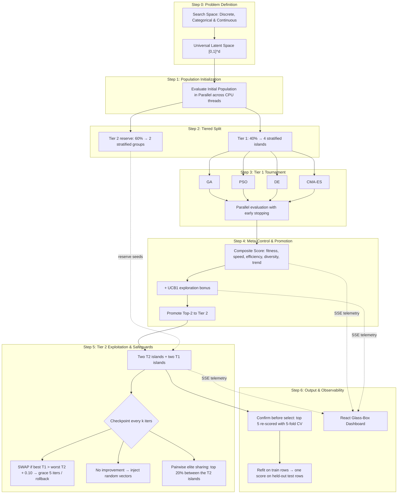
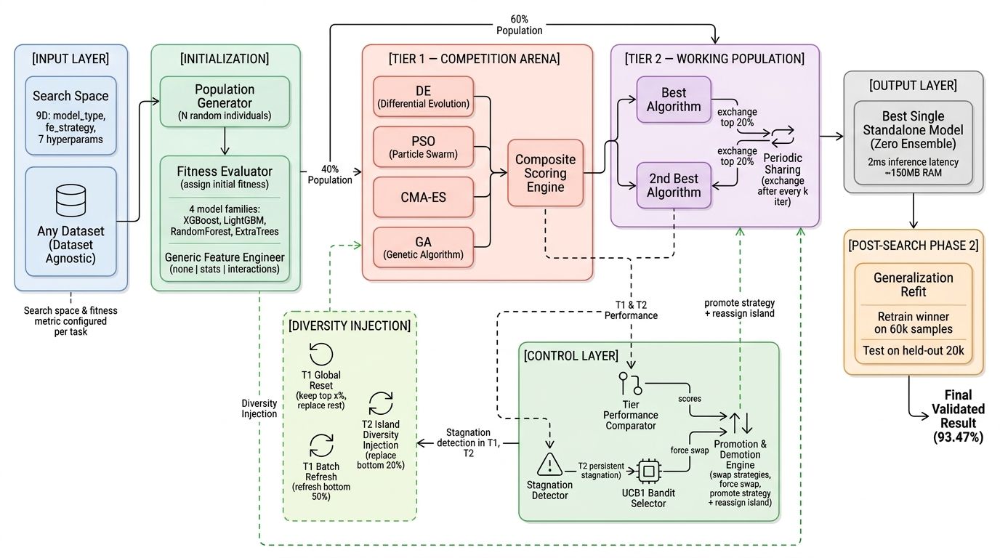

# 01 — Overview & Motivation

## 1. The problem

A model's performance depends heavily on hyperparameters that gradient descent cannot learn. Examples are the learning rate, tree depth, number of estimators, regularisation, layer sizes and the choice of model family. Practitioners usually tune them in one of three ways, and each has a weakness:

1. **Grid search and random search.** Grid search grows exponentially with the number of dimensions. Random search ignores feedback from earlier evaluations.
2. **A single heuristic or Bayesian optimizer**, such as TPE, Gaussian-process Bayesian optimisation, one GA or one PSO. Each algorithm suits some landscapes and fails on others:
   - momentum methods (PSO, CMA-ES) converge fast on smooth surfaces but get trapped in noisy or multi-modal ones;
   - GA and DE explore broadly but converge slowly near the optimum.

   Once such a tool has committed to its sampler, it cannot change strategy when the sampler stalls, so the remaining budget is wasted.
3. **Heavy ensembling** (H2O, AutoGluon stacking). Accuracy improves, but every prediction must pass through 10–50 models. That multiplies inference latency, memory and maintenance cost.

**Problem statement (from the panel deck):** AutoML systems rely on a single fixed optimizer that stagnates on non-convex hyperparameter landscapes, wasting search compute. By the No Free Lunch theorem no single optimizer dominates everywhere, so adaptive strategy switching is needed.

**Research gap:** There are no frameworks that run several optimizers concurrently, detect stagnation live, swap strategies dynamically, and still deliver a single model.

## 2. Objectives

1. Build a UCB1 multi-armed-bandit meta-engine that routes budget to the best-performing optimizer in real time.
2. Switch strategies live (tier SWAPs) based on stagnation and diversity monitoring.
3. Deliver a **single deployable model** instead of an ensemble, and measure its cost. (The panel version reported 93.47% on Covertype and claimed about 2 ms and 150 MB per model; after the fixes, every refit measures latency and size, which depend on the model family. See [08-results.md](08-results.md).)
4. Make the search observable live (a "glass box") through an SSE dashboard.
5. Stay dataset-agnostic: the same engine handles tabular model switching and CNN architecture search.

## 3. The title, word by word

| Title component | What it means in the system | Implemented in |
|---|---|---|
| **Dynamic** | The allocation of budget among optimizers changes during the run through promotion, SWAP, rollback and injection. | `src/evosynth/engine/controller.py` |
| **Multi-Armed Bandit** | Each optimizer is an "arm". Its reward is the composite score, and a UCB1 exploration bonus `c·sqrt(ln N / n_i)` favours under-used arms. | `controller.py` (`_compute_composite`), `engine/bandit.py` |
| **Meta-Optimizer** | It optimises *which optimizer* gets budget, over a portfolio of GA, PSO, DE and CMA-ES arranged in a two-tier island model. | `controller.py`, `optimizers/` |
| **Automated Model Selection** | The model family is one latent dimension (`model_type` ∈ XGBoost / RandomForest / LightGBM / ExtraTrees), so the family is chosen inside the same search loop. | `search_spaces/tabular.py`, `evaluators/` |
| **Hyperparameter Tuning** | Continuous, integer and categorical hyperparameters, plus the feature-engineering gene, are searched together. Evaluation runs in parallel, with early stopping for boosted trees. | `evaluators/tabular.py`, `models/factory.py`, `features/generic.py` |

```
[ EvoSynth ]
    ├── "Dynamic Multi-Armed Bandit" ─► composite score + UCB bonus decide promotion and SWAPs
    ├── "Meta-Optimizer" ─────────────► portfolio of 4 optimizers (GA, PSO, DE, CMA-ES) in 2 tiers
    ├── "Automated Model Selection" ──► model_type gene: XGBoost / LightGBM / RandomForest / ExtraTrees (or a CNN)
    └── "Hyperparameter Tuning" ──────► 8-dimensional latent space, parallel evaluation, early stopping
```

## 4. The No Free Lunch argument

The No Free Lunch theorem for optimisation (Wolpert & Macready, 1997) says that, averaged over all problems, no optimizer outperforms any other. A tool that commits to one sampler is therefore betting that the user's landscape suits that sampler.

EvoSynth does not try to design one perfect algorithm. It keeps a portfolio of algorithms with complementary search behaviour:

| Optimizer | Strength | Weakness |
|---|---|---|
| GA | Global exploration through crossover and mutation | Slow convergence near the optimum |
| PSO | Fast movement driven by personal and global bests | Premature convergence on multi-modal or noisy landscapes |
| DE | Robust navigation by vector differences | Sensitive to loss of diversity |
| CMA-ES | Learns correlations between parameters, so it fine-tunes smooth regions well | Heavier computation, and largely local |

EvoSynth measures each optimizer's progress, diversity and trend online and moves budget to whichever currently performs best. That is the meta-optimizer answer to NFL.

## 5. Why this is not ensembling

| | Ensembling (stacking, blending, voting) | EvoSynth |
|---|---|---|
| Where it operates | Prediction space: combines the outputs of M trained models at inference time | Search space: coordinates M *search algorithms* during offline tuning |
| Deliverable | M models deployed together | **One** model configuration |
| Inference cost | O(M): latency and RAM scale with the number of models | O(1): one model |
| Purpose of the diversity | Averaging reduces variance | Diverse search strategies escape local optima |

The multiple algorithms exist **only during search**. Production receives one lean model, for example an ExtraTrees classifier with interaction features, so there is no inference penalty.

## 6. The seven-stage workflow

The README and paper describe these stages. The controller prints matching "STEP n" headers.

| Stage | Name | What happens |
|---|---|---|
| 0 | Problem definition and latent mapping | The search space (discrete, categorical and continuous) is mapped to `[0,1]^d`. |
| 1 | Parallel population initialisation | `pop_size` (N) random vectors are evaluated in thread-pool batches. |
| 2 | Two-tier split | A **stratified** split: 40% of N go to four equal Tier 1 islands and 60% to two reserve groups, each receiving one member from every fitness-rank stratum, so every island starts with the same mix of good and weak members. |
| 3 | Tier 1 tournament | GA, PSO, DE and CMA-ES evolve their islands for `t1_iters` iterations. Islands without improvement at a check get 50% random injection. |
| 4 | Meta-control and promotion | The composite score (fitness, speed, efficiency, diversity, trend) and the UCB1 bandit rank the families; the top two are promoted and each takes one reserve group. |
| 5 | Tier 2 exploitation and safeguards | T2 and the remaining T1 run until the budget is spent. Every `k` iterations the checkpoint handles SWAP with grace and rollback, stagnation injection, and top-20% elite sharing. |
| 6 | Selection, output and observability | The top 5 distinct configurations are re-scored with 5-fold CV (confirm before select); the selected one is refitted on the dataset's train rows and scored once on its held-out test rows, with latency and size measured. Telemetry streams to the dashboard throughout. |



## 7. The architecture figure (`docs/public/arch.png`), described



The figure (also `paper/figures/arch.png`; source `paper/figures/arch_source.html`) reads left to right in six coloured panels, with a footer of cross-cutting properties. The panel-review figure is kept as `arch_legacy.png`.

1. **Data (blue).**
   - **Dataset registry:** seven tabular datasets and Fashion-MNIST; metric per dataset (accuracy for multiclass, ROC AUC for binary).
   - **Fixed split (data_seed):** test rows split off first and never searched; search rows for cross-validation; train rows for the refit.
   - **Latent search space [0,1]^8:** `model_type`, `fe_strategy` and six hyperparameters.
2. **Evaluation and initialization (green).**
   - **Fitness evaluator:** k-fold CV on the search rows (k = 2); boosted models early-stop on a slice of the training fold; a failed fit scores 0 and is logged.
   - **Population generator:** N random vectors (default 40), evaluated in parallel.
   - **Stratified tier split:** 40% of N to four equal Tier 1 islands, 60% to two equal reserve groups, each with a mix of good and weak members. An arrow over the top carries the reserve to Tier 2.
3. **Tier 1 — Competition (red).** GA, PSO, DE and CMA-ES islands of N/10 members each, running `t1_iters` generations; after promotion the two others keep running and can SWAP back in.
4. **Scoring and control (green).**
   - **Composite score:** fitness 0.30, speed 0.25, efficiency 0.15, diversity 0.15, trend 0.15, min-max normalised over the islands scored together.
   - **UCB1 bandit:** UCB = composite + c·√(ln N / n_family), c = 0.1; it ranks the families for every decision.
   - **Decisions:** promote the top 2; SWAP when the best Tier 1 UCB beats the worst Tier 2 UCB by more than 0.10 (grace period with rollback, cooldown); inject fresh vectors into islands without improvement.
5. **Tier 2 — Exploitation (purple).** Rank-1 and rank-2 families, each its Tier 1 island plus one reserve group; pairwise elite sharing (top 20% each way) every k iterations; a checkpoint every k iterations rescores all islands (k sized automatically so Tier 2 reaches at least two checkpoints).
6. **Selection and output (orange).** Confirm before select (top 5 re-scored with 5-fold CV), refit on the train rows, one held-out test score with measured latency and size, and a single deployable model (`model.pkl` + `result.json`).

**Footer:** reproducible (one seed), configurable (`settings/*.toml`), recorded (manifest, result, logs, scoring history), observable (live dashboard).

## 8. Core claims, and where they stand after the fixes

1. **Escape from premature convergence.** On Covertype, GA was promoted to Tier 2 but stalled. PSO, still in Tier 1, overtook it on UCB score (0.720 vs 0.547) and a live SWAP promoted PSO, which then found the winning configuration (see [08-results.md](08-results.md) §5).
2. **Dataset-agnostic feature engineering.** With no column names, generic row statistics and pairwise interactions lifted Covertype test accuracy into the 93–94% range.
3. **Pareto efficiency.** Accuracy at ensemble level from a single model and a modest budget.
4. **Throughput.** The paper reported 11.5× (44.8 s → 3.9 s) on a synthetic 50k × 25 dataset. Re-measured on Covertype with `evosynth speedup` (see [08-results.md](08-results.md)), almost all of the gain comes from parallel threads; early stopping adds little.
5. **Cross-domain.** The same engine performs CNN architecture search. The panel version used 8×8 handwritten digits (95.33% in the paper); it now uses Fashion-MNIST (28×28 images, 10 classes).

Claims 1–3 were measured on one unseeded panel-review run. The fix plan (Phases 0–6) re-runs them with a fixed seed, held-out test rows and equal treatment of every method; [08-results.md](08-results.md) reports what holds.

---

## Quiz

**1.** What problem does EvoSynth address, in one sentence?
<details><summary>Answer</summary>Most tuners commit the whole budget to one search algorithm, which can stagnate on a given problem; EvoSynth runs four evolutionary optimizers and shifts the budget online to whichever is working.</details>

**2.** Match each word of the title to its part of the system: Dynamic Multi-Armed Bandit, Meta-Optimizer, Automated Model Selection, Hyperparameter Tuning.
<details><summary>Answer</summary>Bandit: the UCB1 ranking that decides promotion and SWAPs. Meta-optimizer: it manages other optimizers (GA, PSO, DE, CMA-ES). Model selection: the `model_type` gene. Hyperparameter tuning: the remaining genes in the 8-D latent space.</details>

**3.** Put the seven stages in order: Tier 1 tournament; selection, output and observability; problem definition and latent mapping; Tier 2 exploitation and safeguards; two-tier split; meta-control and promotion; parallel initialisation.
<details><summary>Answer</summary>Problem definition → parallel initialisation → two-tier split → Tier 1 tournament → meta-control and promotion → Tier 2 exploitation → selection and output.</details>

**4.** With N = 40, how many individuals go to Tier 1, how many per island, and how large is each reserve group?
<details><summary>Answer</summary>Tier 1: 16 (40%), 4 per island; reserve: 24 in two groups of 12.</details>

**5.** Why is the tier split stratified rather than 'best 40% to Tier 1'?
<details><summary>Answer</summary>So every island and reserve group starts with the same mix of good and weak members; no optimizer gets a head start, and the competition measures the algorithms rather than their starting points.</details>

**6.** Which six panels does the architecture figure show, left to right?
<details><summary>Answer</summary>Data; evaluation and initialization; Tier 1 competition; scoring and control; Tier 2 exploitation; selection and output.</details>

**7.** True or false: after the fixes, the 2 ms / 150 MB claim is reported as a fixed property of EvoSynth.
<details><summary>Answer</summary>False. Latency and size are measured for every refitted model and depend on the model family (forests are much larger and slower per row than boosted models).</details>

**8.** What happens after the search and before the final test score is computed?
<details><summary>Answer</summary>Confirm before select (the top 5 distinct configurations re-scored with 5-fold CV), then a refit of the selected configuration on the train rows.</details>

**9.** Why can't the panel-review results simply be reused after the fixes?
<details><summary>Answer</summary>They came from one unseeded run of the v1 engine (with bugs in CMA-ES, PSO and DE, test rows overlapping the search sample, and different metrics), so they are not comparable with the re-runs.</details>
