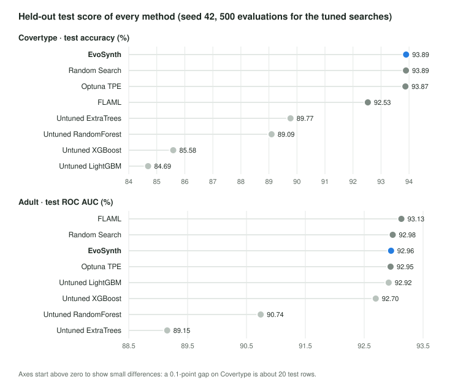
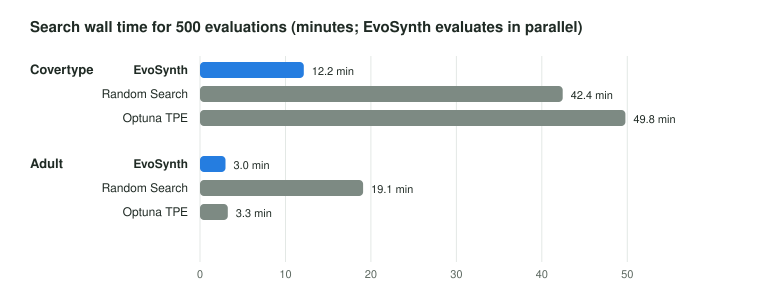
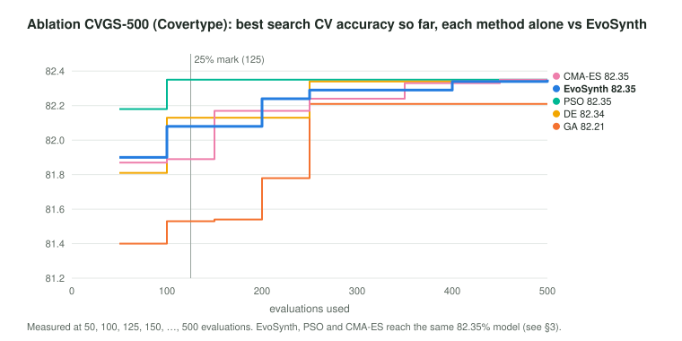
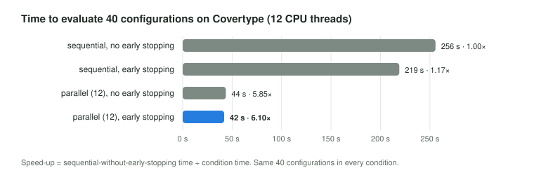

# 08 — Results

This chapter reports the **Phase 5 smoke run**: the first run of the fixed code (Phases 0–4) through the whole experiment harness. Every number comes from a file under `results/`, and each section names it. The tables in `results/summary/` are built by `evosynth summary`; the charts are drawn from the same files by `handbook/figures/make_results_figures.py`.

To reproduce everything in this chapter (about 4 hours on a 12-thread CPU):

```bash
py -3.14 tools/run_experiments.py smoke
```

> **Read this first: one seed.** Every result here is from a single seed (42). Differences of a few tenths of a point between tuned methods are within run-to-run noise, so no claim in this chapter says one tuned method beats another. The `lean` plan (3 seeds, 4 datasets) is the run that can support such claims.

---

## 1. Protocol

| Item | Setting |
|---|---|
| Datasets | **Covertype** (7 classes, accuracy) and **Adult** (2 classes, ROC AUC); fixed splits from `settings/datasets.toml`, published in EvoSynth-Bench v2.0.0 |
| Test rows | Covertype 20,000; Adult 12,000. Split off first; no search or selection ever sees them; each method's final model is scored on them once |
| Search rows | 10,000 per dataset (`--subsample 10000`, a fixed subset of the published 20,000), 2-fold stratified CV |
| Train rows | Covertype 60,000; Adult 36,000; used for the final refit |
| Budget | 500 evaluations for EvoSynth, Random Search and Optuna TPE; population 40 for EvoSynth |
| Selection | Confirm before select: the 5 best distinct configurations are re-scored with 5-fold CV; the best confirmed one is refitted. Identical for EvoSynth, Random Search and Optuna |
| FLAML | Given the same wall time EvoSynth used (Covertype 729 s, Adult 178 s). It searches on the train rows with its own holdout and trains its own final model (FLAML's normal use) |
| Untuned floors | Each of the four model families with library defaults, trained on the train rows |
| Inference | Single-row latency on one thread, batch throughput, and pickled model size, all on the test rows |
| Hardware | One 12-thread laptop CPU; EvoSynth evaluates up to 8 candidates in parallel, the baselines one at a time |

---

## 2. Main comparison



**Covertype** (`results/summary/main_table.csv`, `results/search/covertype/…`, `results/baselines/covertype/…`)

| Method | Search CV | Confirmed CV (5-fold) | **Test accuracy** | Model | Search time | Latency (ms/row) | Size (MB) |
|---|---|---|---|---|---|---|---|
| **EvoSynth** | 82.35 | 84.84 | **93.89** | ExtraTrees + interactions (found by T2_CMAES) | 12.2 min | 12.46 | 470.5 |
| Random Search | 82.10 | — | **93.89** | ExtraTrees + interactions | 42.4 min | 16.74 | 702.1 |
| Optuna TPE | 82.35 | — | 93.87 | ExtraTrees + interactions | 49.8 min | 10.39 | 456.1 |
| FLAML | — | — | 92.53 | LightGBM (850 trees, 1,914 leaves) | 13.0 min | 5.10 | 128.0 |
| Untuned ExtraTrees | — | — | 89.77 | | | 5.36 | 596.0 |
| Untuned RandomForest | — | — | 89.09 | | | 4.92 | 217.2 |
| Untuned XGBoost | — | — | 85.58 | | | 0.55 | 1.96 |
| Untuned LightGBM | — | — | 84.69 | | | 0.46 | 2.40 |

**Adult** (ROC AUC)

| Method | Search CV | **Test ROC AUC** | Model | Search time | Latency (ms/row) | Size (MB) |
|---|---|---|---|---|---|---|
| FLAML | — | **93.13** | XGBoost (1,861 trees) | 3.0 min | 1.51 | 6.82 |
| Random Search | 91.50 | 92.98 | XGBoost | 19.1 min | 0.92 | 2.24 |
| **EvoSynth** | 91.73 | 92.96 | XGBoost, no FE (found by T2_PSO) | 3.0 min | 0.26 | 0.40 |
| Optuna TPE | 91.73 | 92.95 | XGBoost | 3.3 min | 0.27 | 0.33 |
| Untuned LightGBM | — | 92.92 | | | 0.45 | 0.35 |
| Untuned XGBoost | — | 92.70 | | | 0.48 | 0.32 |
| Untuned RandomForest | — | 90.74 | | | 5.08 | 84.3 |
| Untuned ExtraTrees | — | 89.15 | | | 5.16 | 205.6 |



**What the main comparison shows:**
1. **The three tuned searches finish level.** On Covertype, EvoSynth, Random Search and Optuna are within 0.02 points of each other and all chose ExtraTrees with interaction features; on Adult they are within 0.03 points and all chose XGBoost. One seed cannot separate them, and §3 explains why Covertype cannot separate them at all.
2. **Tuning plus model selection matters on Covertype and hardly at all on Adult.** On Covertype the tuned searches are 4.1 points above the best untuned model and 1.4 above FLAML. On Adult the best untuned model (LightGBM, 92.92) is within 0.06 points of the tuned searches.
3. **Model-family choice is the largest lever.** The best family differs by dataset (forests on Covertype, boosting on Adult), and picking the wrong one costs 2–9 points. EvoSynth picked the right family on both.
4. **FLAML won Adult** by 0.15 points. It used a 1,861-tree XGBoost with a very low learning rate and searched on the 36,000 train rows rather than 10,000 search rows. On Covertype it trailed the tuned searches by 1.4 points.
5. **EvoSynth was fastest on Covertype** (12 min against 42–50), because it evaluates candidates in parallel; §6 measures how much of the gain is parallelism. On Adult, where XGBoost evaluations take about a second, Optuna was about as fast (3.3 min against 3.0).

**Why test scores are higher than search CV:** each search fold trains on 5,000 rows with forests capped at 150 trees; the 5-fold confirmation trains on 8,000 rows (84.84%); the refit trains on 60,000 rows. Tree ensembles on Covertype improve strongly with more data. The test rows are never seen before the final score, so the gap is not leakage.

---

## 3. Why every search finds the same Covertype model

On Covertype, the top five configurations of the EvoSynth run all scored exactly 82.35% in the search and exactly 84.84% in confirmation (`results/search/covertype/search_full/seed_42/result.json`). They are different vectors that build **the same model**:

| What the gene says | What the search model uses |
|---|---|
| `n_estimators` 223–379 | capped at 150 trees during the search (`evaluation.search_tree_cap`) |
| `max_depth` 9 | 27 (×3, `bagging_depth_multiplier`) |
| `colsample_bytree` 0.449–0.454 | `max_features` = the same whole number of features |
| `learning_rate`, `subsample`, `reg_alpha` | not used by ExtraTrees |
| same `random_state` | same trees |

So the best region of the Covertype space is a flat plateau with a single top score, and every competent search reaches it: EvoSynth, PSO alone, CMA-ES alone and Optuna all report exactly 82.35%. Once there, no optimizer can do better, which is why the comparisons on Covertype end in ties. This is a property of the search space, not evidence for or against any optimizer. Datasets where boosting wins (Adult, HIGGS) have continuous hyperparameters that matter and are better for comparing optimizers. Making `n_estimators` matter during the search (raising the tree cap) is a candidate change.

---

## 4. Ablation CVGS-500 (Covertype): each optimizer alone vs EvoSynth

**Source:** `results/ablation/covertype/cvgs_500/seed_42/` (`result.json`, `summary.txt`). Each optimizer runs alone with the full 500-evaluation budget and population 40; EvoSynth runs once with the same budget. All five are scored with the same composite scoring engine at 50, 100, …, 500 evaluations and at the 25% mark (125).



| Method | At 125 evals | **At 500 evals** | Diversity at 500 | Composite at 500 | Runtime | Best model |
|---|---|---|---|---|---|---|
| PSO alone | **82.35** | **82.35** | 0.093 | 0.504 | 10.7 min | ExtraTrees + interactions |
| CMA-ES alone | 81.89 | **82.35** | 0.227 | 0.727 | 10.5 min | ExtraTrees + interactions |
| **EvoSynth** | 82.08 | **82.35** | 0.206 | 0.923 | 14.9 min | ExtraTrees + interactions (T2_GA) |
| DE alone | 82.13 | 82.34 | 0.363 | 0.629 | 9.8 min | ExtraTrees + interactions |
| GA alone | 81.53 | 82.21 | 0.085 | 0.200 | 14.9 min | ExtraTrees + interactions |

**Reading:**
- At the full budget **EvoSynth matched the best single optimizer** (82.35, tied with PSO and CMA-ES). At the 25% mark it trailed PSO by 0.27 points.
- The best single optimizer was not known in advance: in the v1 ablations CMA-ES and DE (tied) came out on top, here PSO does. EvoSynth reached the same top score without that choice being made for it.
- GA alone was the worst and collapsed to diversity 0.085. Inside EvoSynth, GA produced the winner after receiving CMA-ES's elites, which shows elite sharing at work.
- EvoSynth's diversity (0.206) stayed above PSO's and GA's but below DE's.
- Engine decisions inside this run: 1 promotion, 14 Tier 1 injections, 2 elite exchanges, no SWAP.
- One seed, and the Covertype plateau (§3) caps every method at 82.35, so this ablation **cannot show EvoSynth beating the best single optimizer**; it shows it does not lose to it.

---

## 5. The engine at work (search runs)

**Covertype** (`results/search/covertype/search_full/seed_42/run.log`; N = 40, 4 islands of 4, Tier 1 for 5 iterations, checkpoint every 3 Tier 2 iterations):

```
TIER 1 (5 iters)   GA 80.09   PSO 81.90   DE 81.82   CMAES 82.08          120/500
SCORING            T1_DE    composite 0.961 + bonus 0.049 = UCB 1.010   -> PROMOTED
                   T1_CMAES composite 0.417 + bonus 0.049 = UCB 0.466   -> PROMOTED
                   T1_PSO   UCB 0.344 (diversity 0.050)    T1_GA  UCB 0.049
TIER 2 iter 3      T2_CMAES finds 82.35 (global best)                    240/500
CHECKPOINT 1       [SWAP] T1_GA (UCB 0.592) beats T2_DE (UCB 0.369) by > 0.10
                   [ELITE SHARE] T2_CMAES <-> T2_GA, top 3 each way
CHECKPOINT 2       T2_GA reaches 82.35 (through the shared elites)        360/500
                   [ELITE SHARE] T2_CMAES <-> T2_GA
iter 8             [ROLLBACK] GA did not improve the global best in its 5-iteration grace period -> DE back
CHECKPOINT 3       T2_DE composite 0.992 -> UCB 1.017; [ELITE SHARE] T2_CMAES <-> T2_DE
FINAL              500 evals, 12 min 9 s, winner T2_CMAES 82.35% -> confirmed 84.84% -> test 93.89%
```

- **DE was promoted with a lower best score than CMA-ES's** because it was still improving and had the most diverse island (speed, efficiency and trend make up 55% of the composite).
- **The SWAP promoted GA**, which was improving fast from a low score. GA did not beat the global best in its grace period, so the **rollback** restored DE. This is the safeguard working as designed. It also shows a weakness: GA tied the best through CMA-ES's elites, and a tie does not count as an improvement.
- **PSO collapsed in Tier 1** (diversity 0.050 throughout) and was never promoted.

**Adult** (`results/search/adult/search_full/seed_42/run.log`): GA and PSO were promoted; two SWAPs followed (CMA-ES replaced GA, then DE replaced CMA-ES); the winner was **T2_PSO**, a 375-tree XGBoost with no feature engineering, in 2 min 59 s.

The winning family differs between the two runs (CMA-ES on Covertype, PSO on Adult, GA in the ablation), which is the situation the portfolio is designed for.

---

## 6. Speed-up from parallel evaluation and early stopping

**Source:** `results/speedup/covertype/default/seed_42/result.json` (`evosynth speedup`). The same 40 random configurations are evaluated under four conditions on Covertype's 10,000 search rows.



| Condition | Time | Speed-up | Mean CV score |
|---|---|---|---|
| Sequential, no early stopping | 255.6 s | 1.00× | 76.90 |
| Sequential, early stopping | 219.0 s | 1.17× | 76.53 |
| Parallel (12 threads), no early stopping | 43.7 s | 5.85× | 76.90 |
| **Parallel (12 threads), early stopping** | **41.9 s** | **6.10×** | 76.53 |

- **The measured speed-up is 6.1×**, almost all of it from parallel evaluation. Early stopping adds 17% on its own and 4% on top of parallelism, at a cost of 0.37 points in mean CV score.
- The **11.5× claim in the v1 paper is not reproduced**: it had no measurement code. The 3.8× of the Phase 4 check was measured on a smaller sample. The correct figure for the paper is "about 6× on 12 threads, mostly from parallel evaluation".
- Parallel evaluation is an engineering feature that any tuner can use (Optuna can run trials in parallel too). It explains EvoSynth's shorter wall time in §2; it is not an advantage of the search method.

---

## 7. Inference cost of the selected models

The v1 material claimed "about 2 ms per prediction and about 150 MB" for the winning model. The measurements (single row, one thread):

| Selected model | Latency (ms/row) | Size (MB) |
|---|---|---|
| Covertype: ExtraTrees + interactions (EvoSynth) | 12.46 | 470.5 |
| Covertype: LightGBM (FLAML) | 5.10 | 128.0 |
| Adult: XGBoost (EvoSynth) | 0.26 | 0.40 |
| Adult: XGBoost (FLAML) | 1.51 | 6.82 |

- **The 2 ms / 150 MB claim does not hold for the Covertype winner.** A deep 232-tree ExtraTrees with interaction features is large and slow per row. It is true for boosted models: the Adult winner is a quarter of a millisecond and under half a megabyte.
- The single-model argument still stands in its accurate form: EvoSynth ships one model, so serving costs whatever that one model costs. On Covertype the most accurate model is a big forest; a search that also rewarded size or latency would pick a smaller one. That is a multi-objective extension, not something the current search does.

---

## 8. Neural architecture search (Fashion-MNIST)

**Source:** `results/nas/fashion_mnist/default/seed_42/` (`evosynth nas`). 160 evaluations, population 40, each candidate trained for 2 epochs on 10,000 images and scored on 2,500 validation images, on CPU.

| Result | Value |
|---|---|
| Best validation accuracy | **81.80%** |
| Best architecture | conv 16 → conv 128 → fc 256, dropout 0.17, ReLU, Adam, learning rate 0.009 |
| Winner | T2_PSO |
| Time | 15 min 12 s |

- This shows that the same engine and latent space handle a different kind of search space (channels, activations, optimizers) with no code changes.
- The v1 figure (95.3–95.8% on the 8×8 sklearn digits) is not comparable: Fashion-MNIST is a much harder 28×28 dataset, and 2 epochs on 10,000 images is a deliberately small training budget. The number is a validation score, not a held-out test score.

---

## 9. What changed since the v1 (panel-review) results

| v1 claim | Now | Why it changed |
|---|---|---|
| 94.05% Covertype test at 500 evaluations | 93.89% | v1's test rows could overlap the search sample; the search now uses 10,000 rows instead of 20,000; refit protocol fixed |
| Beats Optuna (89.80) by 4.25 points | Ties Optuna (93.87) | v1 refitted Optuna and Random Search with default hyperparameters and 150 trees; now all three use the same confirm-and-refit |
| Random Search 93.92 at 120 evaluations | Random Search 93.89 at 500, tied | Same fix |
| Untuned floors 81–81.5% (XGB, LGBM, RF) | 84.7–89.8% | v1 floors were reported without a generating script; now measured on the same split |
| Speed-up 11.5× | 6.1× | Now measured by `evosynth speedup` |
| 2 ms / 150 MB per model | 12.5 ms / 470 MB (Covertype), 0.26 ms / 0.4 MB (Adult) | Now measured |
| Ablation diversity and UCB for EvoSynth | Measured | v1 used hard-coded constants for EvoSynth's values |
| One dataset | Two datasets (eight supported) | Phase 3 |

The v1 files are kept in `results/archive/2026-11-19_covertype_v1/` and the v1 code at git tag `v1-panel-review`.

---

## 10. Overall reading of the evidence

1. **The mechanics work and are now measured.** Promotions, SWAPs, rollbacks, injections and elite sharing all happen in the logs, and the decisions follow the composite scores.
2. **EvoSynth is as accurate as the strong baselines, not more accurate.** On both datasets it ties Random Search and Optuna under an identical protocol, and it matches the best single optimizer in the ablation. With one seed, no ranking among the tuned searches is supported.
3. **Its practical gains are robustness and wall time.** It reached the top score without knowing in advance which optimizer suits the problem (the best single optimizer changed between v1 and now), and its parallel evaluation made it the fastest on Covertype.
4. **Model selection and feature engineering matter more than the optimizer.** Picking ExtraTrees with interactions on Covertype and XGBoost on Adult is worth 2–9 points; the choice of optimizer, once a good region is found, is worth hundredths.
5. **The benchmark needs to be harder to separate optimizers.** The Covertype plateau caps every method at the same model. The `lean` plan (3 seeds; Covertype, HIGGS, Adult and Poker Hand) and the proposals in the To-do page (surrogate benchmarks, an NGOpt baseline) address this.

---

## Quiz

**1.** Why does this chapter avoid saying EvoSynth "beats" Optuna on Covertype, even though 93.89 > 93.87?

<details><summary>Answer</summary>

The difference is 0.02 points (about 4 of 20,000 test rows) from a single seed. Run-to-run variation between seeds is larger than that, so the two results are a tie until several seeds show a consistent gap.
</details>

**2.** The five best Covertype configurations had different `n_estimators` values but identical scores. Why?

<details><summary>Answer</summary>

During the search, forests are capped at 150 trees, so any `n_estimators` above 150 builds the same 150 trees. Depth 9 always maps to 27, the `colsample_bytree` values round to the same number of features, and ExtraTrees ignores `learning_rate`, `subsample` and `reg_alpha`. With the same random seed, they are the same model.
</details>

**3.** Test accuracy on Covertype (93.89%) is much higher than search CV accuracy (82.35%). Is that leakage?

<details><summary>Answer</summary>

No. The search trains on 5,000 rows per fold with at most 150 trees, while the refit trains on 60,000 rows. Forests on Covertype improve strongly with more data. The test rows are split off first and never seen until the final score.
</details>

**4.** Which method won Adult, and what was different about how it searched?

<details><summary>Answer</summary>

FLAML (93.13 ROC AUC). It searched on the 36,000 train rows with its own holdout instead of the 10,000 search rows, and it chose a 1,861-tree XGBoost with a very low learning rate.
</details>

**5.** In the speed-up benchmark, how much of the 6.1× comes from early stopping?

<details><summary>Answer</summary>

Very little. Early stopping alone gives 1.17× and adds only about 4% on top of parallel evaluation (5.85× → 6.10×). Almost all the speed-up comes from evaluating candidates on 12 threads in parallel.
</details>

**6.** In the Covertype search, GA was swapped into Tier 2 and then rolled back. Why was it rolled back, even though it reached 82.35%?

<details><summary>Answer</summary>

Rollback checks whether the promoted family improved the **global best** within its 5-iteration grace period. GA only tied the existing 82.35%, which it reached through elites shared by CMA-ES, so it did not count as an improvement and DE was restored.
</details>

**7.** What does the CVGS-500 ablation show, and what can it not show?

<details><summary>Answer</summary>

It shows EvoSynth matched the best single optimizer (PSO, 82.35) without being told in advance which optimizer to use. It cannot show EvoSynth beating the best single optimizer, because every good method hits the same 82.35% plateau and there is only one seed.
</details>

**8.** Is the "2 ms per prediction, 150 MB" claim true?

<details><summary>Answer</summary>

Not for Covertype: the selected ExtraTrees takes 12.5 ms per row and is 470 MB. It is true (and better) for the Adult winner, an XGBoost at 0.26 ms and 0.4 MB. Latency and size depend on the model family that wins.
</details>

**9.** Why did EvoSynth finish the Covertype search 3.5× faster than Random Search?

<details><summary>Answer</summary>

Because it evaluates up to 8 candidates in parallel threads, while the baselines evaluate one trial at a time. It is an engineering advantage, not a property of the search algorithm.
</details>

**10.** What would make the benchmark better at separating optimizers?

<details><summary>Answer</summary>

More seeds (to measure variance), datasets where continuous hyperparameters matter (such as HIGGS and Adult, where boosting wins), removing the Covertype plateau (for example by raising the search tree cap), and standard surrogate benchmarks with many tasks.
</details>
